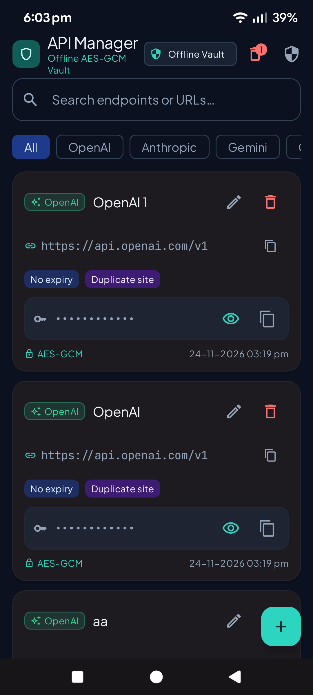
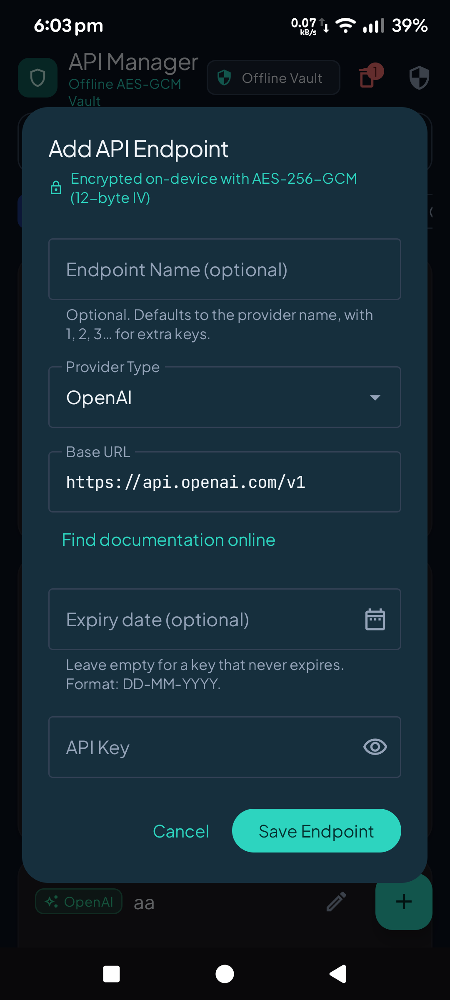
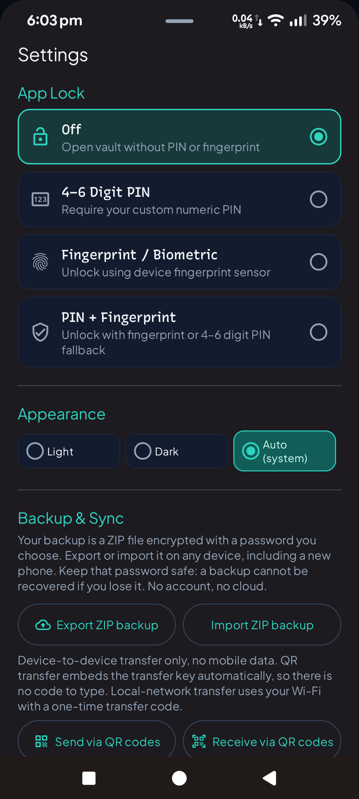
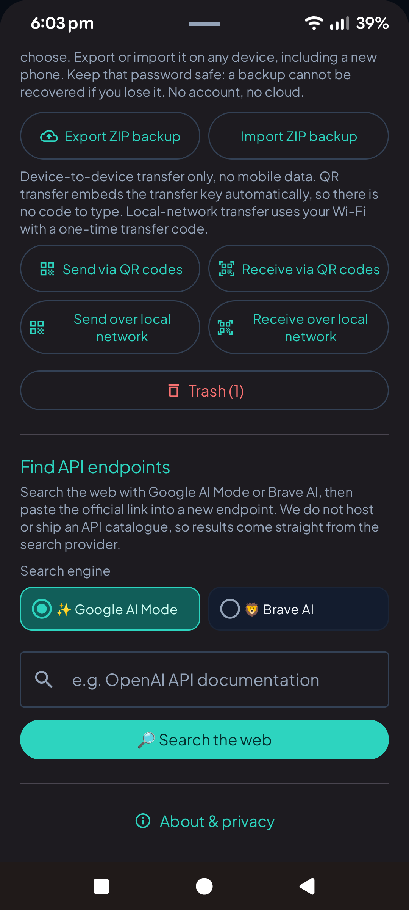

# API Manager

> ⚠️ **Early, AI-assisted side project — not security-audited. Not intended for important or production API keys yet.** Built for personal use and open-sourced in case it helps someone. Use at your own risk; if you need something battle-tested, use Bitwarden/KeePass instead.

A lightweight, offline-first Android vault for API endpoints and keys.

No accounts, ads, analytics, Firebase, or Google Play services. Keys stay encrypted on-device and only leave when you export a backup or start a QR/LAN transfer.

## Screenshots

<p align="center">
  
  
  
  
</p>

## Features

- 🔐 Encrypted on-device storage (AES-256-GCM, Android Keystore)
- 🔒 Optional PIN and/or biometric lock
- 🌗 Light, dark, and auto themes
- 📅 Optional expiry date in `DD-MM-YYYY`
- 🗑️ Trash with 14-day auto-purge, restore, and empty-trash confirmation
- 🧩 Duplicate keys for one site are badged and named `1`, `2`, `3`, …
- 📋 Copy endpoint URL in one tap
- 💾 Password-encrypted ZIP backup that moves across phones
- 📱 QR and LAN device-to-device transfer
- 🔎 Google AI Mode or Brave AI search
- 🧭 Direct links to OpenAI, Anthropic, Gemini, Groq, and OpenRouter

## Backup and transfer

- **ZIP backup:** password-encrypted ZIP. Use the same password to restore on a new phone or after uninstalling.
- **QR:** sender shows QR chunks; receiver scans them. The transfer key travels in the QR code, so no separate code is typed.
- **LAN:** sender shows one QR code over Wi-Fi; receiver scans and connects. No separate code is typed.
- Moving to a new phone: use QR, LAN, or a password-protected ZIP backup while the old device is available.
- App lock still uses your normal PIN or biometrics.

## Build (Windows)

Double-click `build-apk.cmd`, or:

```powershell
powershell -ExecutionPolicy Bypass -File .\build-apk.ps1
```

Manual signing (set these in your own shell):

```powershell
$env:JAVA_HOME='C:\Program Files\Android\Android Studio\jbr'
$env:STORE_PASSWORD='<your-keystore-password>'
$env:KEY_PASSWORD='<your-key-password>'
$env:KEYSTORE_PATH='C:\path\to\my-upload-key.jks'
& '.\gradlew.bat' assembleRelease --no-daemon
```

`build-apk.ps1` prompts for the password when needed. Release output:

```text
app/build/outputs/apk/release/app-release.apk
```

Without signing credentials, the release APK stays unsigned for reproducible CI builds.

## Publishing

- GitHub: <https://github.com/arvind-ranga/api-manager>
- Not intended for Google Play

## Security

- No API keys, release keystores, `.env`, `local.properties`, `google-services.json`, or cloud credentials are committed.
- Signing passwords come from environment variables or a secure prompt.
- `*.jks` and `*.keystore` are gitignored. Only the standard debug keystore is tracked.

## Support

- 💛 Ko-fi: <https://ko-fi.com/arvindranga>
- 💚 GitHub Sponsors: <https://github.com/sponsors/arvind-ranga>
- 🇮🇳 UPI: `electriclegend@yescred`

## License

MIT. See [LICENSE](LICENSE).